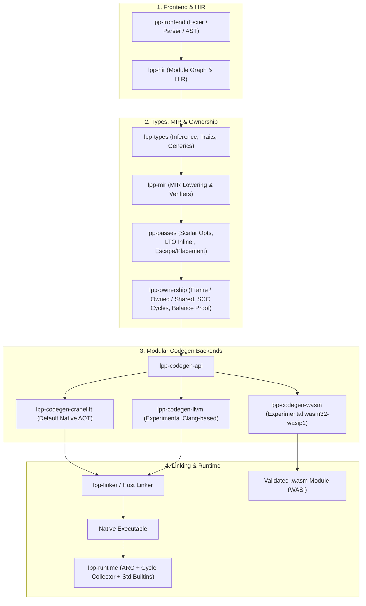

# L++ Architecture Documentation

> Modular rewrite architecture across `crates/lpp-*` and `crates/keel`. For verified per-backend boundaries and limitations, see [specs.md](specs.md) and [documentation/CURRENT_CAPABILITIES.md](documentation/CURRENT_CAPABILITIES.md).

---

## 1. Overview & Workspace Architecture

L++ is a statically typed compiled systems and application language built on a verified multi-stage Rust workspace (`crates/lpp-*`):

- **CLI Entrypoint**: [`src/main.rs`](src/main.rs) unconditionally invokes `lpp_driver::RewriteEngine`.
- **Hosted Runtime**: [`crates/lpp-runtime`](crates/lpp-runtime) (atomic ARC, Bacon-Rajan trial-deletion cycle collector for native `Shared` objects, strings, collections, OS/file/JSON builtins), paired with freestanding C/platform sources under [`runtime/`](runtime/).
- **Direct & Host Linking**: [`crates/lpp-linker`](crates/lpp-linker) provides standalone ELF/PE/Mach-O linking (`lpp-link`), with host C toolchain fallback (`--linker host`).

---

## 2. Compilation Pipeline

### Workspace Crate Breakdown

| Subsystem | Crate(s) | Responsibility |
|---|---|---|
| **Frontend** | [`crates/lpp-frontend`](crates/lpp-frontend) | Tokenization, indentation/escape validation, parsing into typed AST. |
| **HIR & Module Graph** | [`crates/lpp-hir`](crates/lpp-hir) | Resolves imports (including staged `.lpp_packages/*`), constructs HIR. |
| **Type System** | [`crates/lpp-types`](crates/lpp-types) | Bidirectional type inference, monomorphization, trait & generic checking. |
| **MIR & Verification** | [`crates/lpp-mir`](crates/lpp-mir) | Control-flow graph lowering, `CORE_MIR_INVARIANTS` verifier, MIR interpreter & ARC leak oracle (`E4304`). |
| **Passes & Ownership** | [`crates/lpp-passes`](crates/lpp-passes), [`crates/lpp-ownership`](crates/lpp-ownership) | Constant folding, DCE, `--lto`/`--pgo-use` inliner, three-tier placement (`Frame`/`Owned`/`Shared`), SCC cycle classification, and balance proofs (`E4403`). |
| **Codegen Backends** | [`crates/lpp-codegen-api`](crates/lpp-codegen-api), [`crates/lpp-codegen-cranelift`](crates/lpp-codegen-cranelift), [`crates/lpp-codegen-llvm`](crates/lpp-codegen-llvm), [`crates/lpp-codegen-wasm`](crates/lpp-codegen-wasm) | Cranelift (default native `x86_64`/`aarch64`), experimental LLVM, and experimental `wasm32-wasip1` emission. |
| **Linking & Runtime** | [`crates/lpp-linker`](crates/lpp-linker), [`crates/lpp-runtime-abi`](crates/lpp-runtime-abi), [`crates/lpp-runtime`](crates/lpp-runtime) | Direct ELF/PE/Mach-O linker, `abi/builtins.toml`-driven ABI tables, and hosted runtime. |
| **Package Manager & Driver** | [`crates/keel`](crates/keel), [`crates/lpp-pm`](crates/lpp-pm), [`crates/lpp-driver`](crates/lpp-driver) | `Keel.toml`/`Keel.lock` resolution, decentralized git registry client, session & CLI orchestration. |

---

## 3. Memory & Lifetime Model

- **Three-Tier Ownership Plan**: `lpp-ownership` classifies locals into `Frame`, `Owned`, and `Shared`. Cycle-capable types identified by SCC analysis are placed in `Shared` and tracked for collection on the Cranelift native path. See [documentation/CYCLE_BREAKING.md](documentation/CYCLE_BREAKING.md).
- **Atomic Native ARC Headers**: Native runtime reference counting uses atomic operations across `Shared` objects (see [documentation/CONCURRENCY.md](documentation/CONCURRENCY.md)). Strings and destructor-free objects use a 16-byte common ARC header immediately before payload; destructor-bearing native objects prepend an 8-byte destructor pointer (24-byte total prefix).
- **Trial-Deletion Cycle Collection**: Unreachable runtime reference cycles on Cranelift native targets are collected by the Bacon-Rajan trial-deletion collector in `lpp-runtime`. WASM uses a target-specific 24-byte header with free-list reuse for acyclic churn, and cycle collection on WASM/LLVM remains unimplemented.
- **Trapping Arithmetic & Bounds**: Signed division/modulo by zero, overflow (`MIN / -1`), invalid shift counts, and out-of-bounds indexing trap safely rather than invoking undefined behavior.
